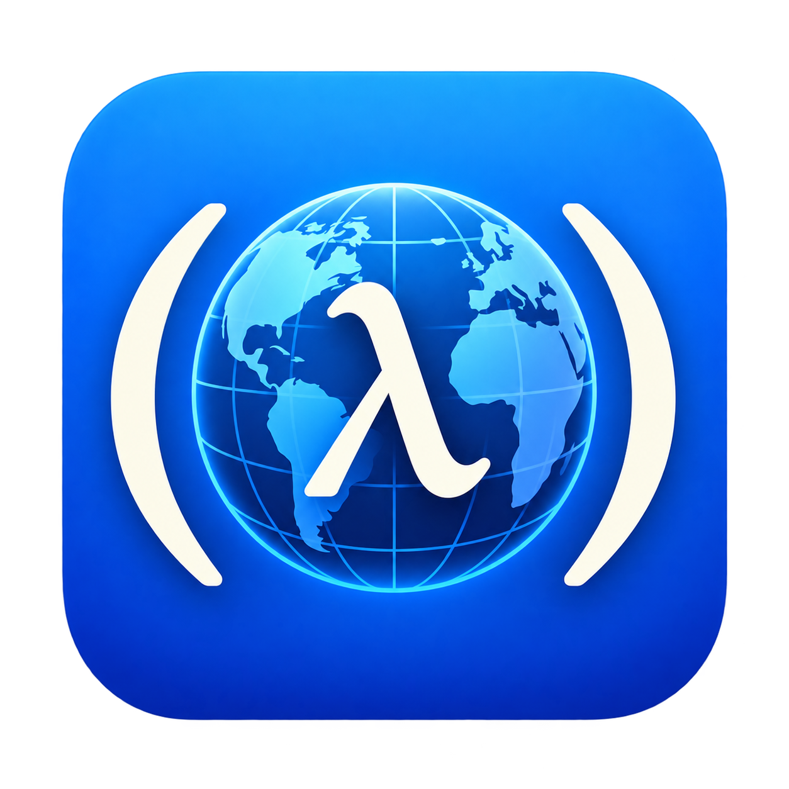

<p align="center">
  
</p>

<h1 align="center">Netscheme</h1>

<p align="center">A toy web browser whose pages are written in a small Lisp instead of HTML, CSS and JavaScript.</p>

One language covers structure, style and behaviour:

```lisp
(define (greeting name) (str "Hello, " name "!"))   ; behaviour

(page :title "Hello"
  (h1 :color "#b8336a" (greeting "world"))           ; structure + style
  (p "6 × 7 = " (* 6 7)))
```

A page is a program. The browser evaluates it, and the last value it
produces, a `(page ...)` element, is the document. Clicking a button changes
some state, and the browser runs the page again.

Netscheme draws everything itself, from the text to the caret in the address
bar, with no GUI toolkit: parsing, styling, layout and painting are the
interesting parts of a browser, so it does them in Rust.

## Running it

```sh
cargo run                                   # opens the guide, pages/hello.sx
cargo run -- path/to/page.sx
cargo run -- page.sx --screenshot out.png   # draws a page to a PNG, without a window
cargo test
```

To try loading pages over the web, run `python3 -m http.server` in `pages/`
and open `http://localhost:8000/hello.sx`.

## The guide

The browser opens on its own guide, written in Netscheme. Its examples are
printed from the same code they run, so they always show what they make.
Choose **View source** in the toolbar on any page to read it.

| Chapter | |
|---|---|
| [Pages are programs](pages/tour.sx) | Elements, attributes, components, images, canvases and links |
| [Styles are values](pages/styles.sx) | Style attributes, combining styles, dark mode |
| [State and events](pages/state.sx) | Clicks, text inputs, animation and keys |
| [The language](pages/language.sx) | Values, special forms, functions, errors and limits |
| [The library](pages/library.sx) | Every builtin, and the prelude |
| [Code is data](pages/code-as-data.sx) | `source`, quasiquote, frames, and the browser as a page |
| [Using the browser](pages/using.sx) | Navigating, keys, finding, the REPL, settings, screenshots |
| [How it works](pages/internals.sx) | From source to pixels, module by module, and the crates it's built on |

Demos, including a canvas, Snake, and a Game of Life, are linked from the home page.

## Desktop integration

The window identifies itself as `netscheme`: that's its app ID on Wayland and
its class on X11, so window manager rules, like Hyprland's `class:netscheme`,
and desktop entries can match it. On X11 and Windows the window carries the
logo as its icon.

macOS takes no icon from the window, so the browser gives the logo to the
running application instead, which is what the Dock and the app switcher show.
That works without an app bundle, so `cargo run` gets the icon too.

Wayland compositors take icons from a desktop entry instead. Build with
`cargo build --release`, copy `assets/images/logo.png` to
`~/.local/share/icons/hicolor/256x256/apps/netscheme.png`, and write a
`~/.local/share/applications/netscheme.desktop`:

```ini
[Desktop Entry]
Type=Application
Name=Netscheme
Icon=netscheme
StartupWMClass=netscheme
Exec=/path/to/toy-browser/target/release/netscheme
Path=/path/to/toy-browser
```

`Path=` is this folder, so the guide and the logo are found when the browser
is started from a launcher.

## Layout

| Folder | |
|---|---|
| `src/` | The browser: the Lisp interpreter in `src/lisp/`, then loading, styling, layout, painting and the window |
| `ui/` | The browser's own pages, at `browser:` locations: the toolbar, view source, and the prelude |
| `pages/` | The guide and demos |
| `assets/` | The logo and the bundled Liberation and Open Sans fonts |

## Roadmap

1. Forward history.
2. More of the language: macros, tail calls.

## License

MIT, in `LICENSE`. The bundled Liberation and Open Sans fonts are under the
SIL Open Font License, in `assets/fonts/LICENSE-Liberation` and
`assets/fonts/LICENSE-OpenSans`. Open Sans Medium is an instance of the
variable Open Sans, made with fontTools.
